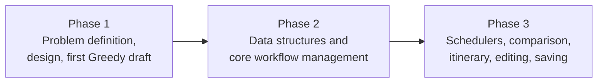
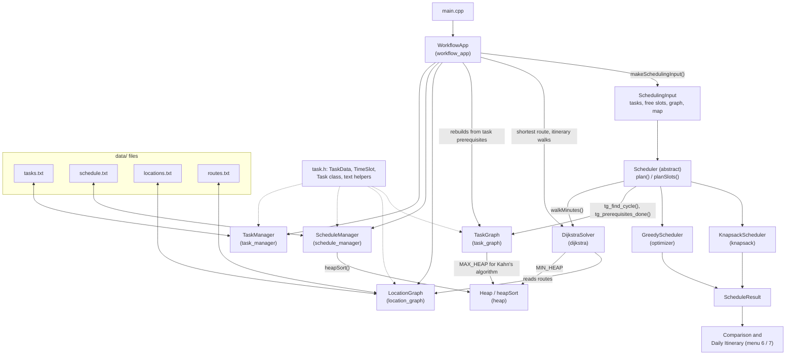
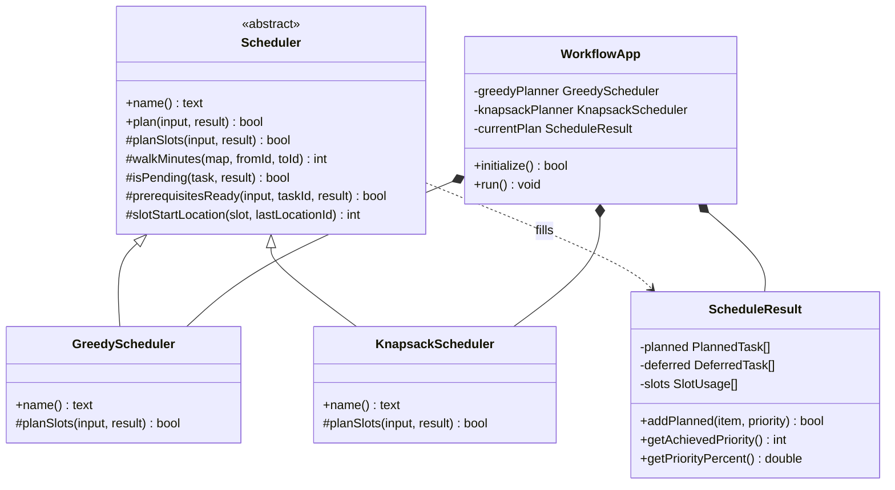
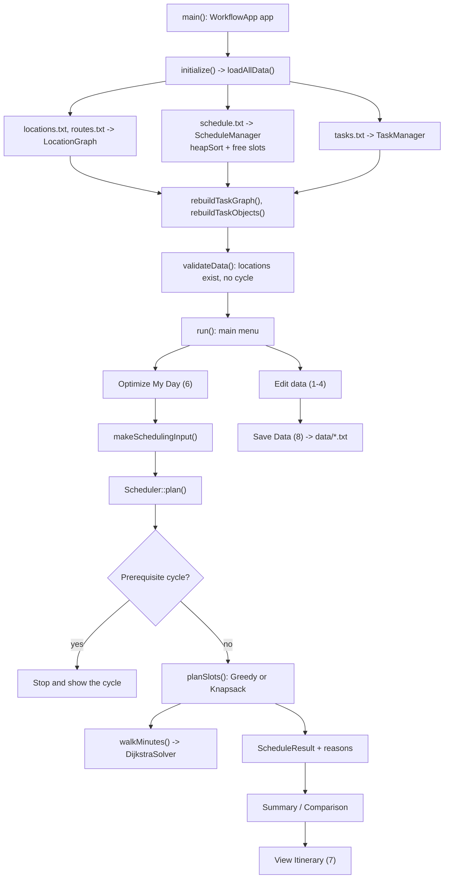

# Priority Based Workflow Optimizer for Efficient Time Utilization

**Turn the gaps in a college timetable into a realistic, walkable plan — with task priorities, prerequisites and campus walking time all taken into account.**


A C++ console application built as a **Project-Based Learning (PBL)** project at Graphic Era Hill University by **Team Cloud9**.

Given a day's timetable, a to-do list and a campus map, the program answers one practical question: **"Which pending task should I do in which free period — and can I actually get there and back in time?"**

It does this by combining the free periods in the timetable, each task's priority, duration and prerequisites, and the **shortest walking time between buildings** (Dijkstra's algorithm). Two different planners — a **Greedy** planner and a **0/1 Knapsack dynamic-programming** planner — build the day's plan, and the program compares them side by side.

The heap, graphs, linked lists and dynamic arrays are written by hand. No STL containers (`vector`, `map`, ...) or STL algorithms (`sort`, `priority_queue`, ...) are used.

---

## Contents

1. [Project Overview](#1-project-overview)
2. [Key Features](#2-key-features)
3. [Development Journey](#3-development-journey)
4. [Technology Stack](#4-technology-stack)
5. [System Architecture](#5-system-architecture)
6. [Architecture Diagram](#6-architecture-diagram)
7. [Project Folder Structure](#7-project-folder-structure)
8. [Module Connections and Data Flow](#8-module-connections-and-data-flow)
9. [Data Structures, Algorithms and OOP](#9-data-structures-algorithms-and-oop)
10. [How to Run the Project](#10-how-to-run-the-project)
11. [Application Usage Guide](#11-application-usage-guide)
12. [Sample Workflow](#12-sample-workflow)
13. [Algorithm Complexity](#13-algorithm-complexity)
14. [Testing and Verification](#14-testing-and-verification)
15. [Limitations and Future Improvements](#15-limitations-and-future-improvements)
16. [Team Contributions](#16-team-contributions)
17. [Conclusion](#17-conclusion)

---

## 1. Project Overview

### The problem

A typical college day has fixed lectures and labs with **free periods** in between. Students usually also carry a list of small but important jobs: submit a lab record, return a library book, revise for a test, meet the project group.

These free periods are often wasted, not because of laziness, but because deciding what to do is harder than it looks:

| Question | Why it matters |
|---|---|
| **How much time is really free?** | A 55-minute gap is not 55 usable minutes if you must walk to another building and then reach your next class on time. |
| **Which task is most important?** | Priority matters, but a very important 55-minute task cannot fit into 35 usable minutes. |
| **Can this task be started yet?** | Some work depends on other work ("revise the notes before solving the practice set"). |
| **Where is the task done?** | Tasks happen in different buildings; walking between them costs time. |
| **What comes after the free period?** | If a lab starts in another building at 12:00, the walk there must fit inside the free period. |

A plain to-do list records tasks, but it does not combine all five questions into a plan. Sorting by priority alone is also not enough: the "most important" task may not fit, may be blocked by a prerequisite, or may be in a building that is too far away.

### How this project solves it

The program reads four plain-text data files — **tasks**, **timetable**, **campus locations** and **walking routes** — and for every free period it considers:

1. the **available free time** in the period,
2. each task's **duration**,
3. each task's **priority** (1–10),
4. each task's **prerequisites** (they must be done or planned earlier),
5. the student's **current location** (the class just before, or where the previous task ended),
6. the task's **location** (destination),
7. the **shortest walking time** between buildings (Dijkstra's algorithm),
8. the walk needed to reach the **next fixed class** before it starts.

From this it builds a plan with exact start and end times, a timeline of the whole day (classes, walks, tasks and spare minutes), and a list of tasks that could not be planned — each with a reason.

### A real example from the sample data

The sample Monday has a lecture in the **Department Block** until 11:05, a free period from **11:05 to 12:00**, and a lab in the **Electronics Lab** at **12:00**.

The most important task, *Submit Lab Record* (priority 10, 15 minutes), is at the **Admin Office**:

```text
Department Block -> Admin Office            4 min walk
Admin Office     -> ... -> Electronics Lab  16 min walk (shortest route)
Usable time at the Admin Office = 55 - 4 - 16 = 35 minutes
```

So the task fits, with 20 more minutes left for other work on the way. The planners then decide what to add, and the itinerary shows the exact walking route and times (see [Sample Workflow](#12-sample-workflow)).

---

## 2. Key Features

### What makes this project different

| A conventional to-do list app (typical) | This workflow optimizer |
|---|---|
| Lists tasks; ordering is mostly manual | Ranks tasks by priority, then duration, then ID, and places them into free periods automatically |
| Usually has no model of walking between places | Uses a weighted campus graph and Dijkstra's algorithm for walking times |
| Dependencies, if any, are often simple reminders | Stores prerequisites in a directed graph, detects cycles, and plans a task only after its prerequisites |
| Does not usually derive free time from a timetable | Detects free periods from the fixed timetable and knows the class before and after each one |
| Usually one way of ordering tasks | Two planners (Greedy and 0/1 Knapsack DP) with a side-by-side comparison |

*Some to-do and calendar apps do offer some of these features; the comparison describes typical basic task lists, not every product.*

### Feature details

<details>
<summary><b>Priority-based task selection</b></summary>

- **What:** a single ranking rule for tasks — higher priority first; if equal, the shorter task; if still equal, the lower ID.
- **Why:** gives a clear, repeatable answer to "which task first?". Preferring shorter tasks on ties makes them easier to fit into a slot.
- **How:** `Task::ranksHigherThan()` and `Task::operator>` in `task.h/.cpp`. The Greedy planner, the "pending tasks by priority" list and Kahn's algorithm all use this order.
</details>

<details>
<summary><b>Free-slot detection from a fixed timetable</b></summary>

- **What:** every period marked `FREE` in `schedule.txt` becomes a free slot, together with the building of the class just before it and just after it.
- **Why:** the planners need to know when the student is free, where they start and where they must be when the slot ends.
- **How:** `schedule_manager` validates periods (valid times, no overlap, correct location for the type), sorts them by start time with `heapSort()`, and builds the slots in `sm_build_free_slots()`. Unlisted gaps (such as a tea break) are not used.
</details>

<details>
<summary><b>Graph-based campus navigation with Dijkstra's algorithm</b></summary>

- **What:** the campus is a weighted, undirected graph (buildings and walking minutes). The program finds the shortest route and its time between any two buildings.
- **Why:** the direct path is not always the shortest. In the sample data, Department Block → Computer Lab is 12 minutes directly but 9 minutes via the Library.
- **How:** `location_graph` stores an adjacency list of linked lists. `DijkstraSolver` (`dijkstra.h/.cpp`) uses the hand-written `Heap` as a min-heap with lazy deletion and rebuilds the path from a predecessor array. Unreachable buildings are reported instead of crashing.
</details>

<details>
<summary><b>Task dependency management and circular-dependency detection</b></summary>

- **What:** prerequisites are stored as a directed graph (`A → B` means A must be done before B). A cycle such as `T1 → T2 → T1` is detected and printed.
- **Why:** a task in a cycle can never start; planning must stop and the data must be fixed.
- **How:** `task_graph` uses adjacency lists and a recursive DFS with three states (unvisited, visiting, done) in `tg_find_cycle()`. When a task is added or updated from the menu, the graph is rebuilt and checked; a change that would create a cycle is **undone**.
</details>

<details>
<summary><b>Topological ordering with Kahn's algorithm</b></summary>

- **What:** prints a valid order of all tasks in which every task comes after its prerequisites.
- **Why:** shows a feasible order for the whole to-do list, independent of the timetable.
- **How:** `tg_topological_sort()` uses in-degrees and a **max-heap**, so when several tasks are ready the higher-priority one comes first (menu 4 → 6).
</details>

<details>
<summary><b>Two planners: Greedy and 0/1 Knapsack dynamic programming</b></summary>

- **What:** both planners fill the free slots in time order, but choose tasks differently.
- **Why:** Greedy is simple and fast but can make a choice that blocks a better combination; the DP planner looks at combinations of tasks within each slot.
- **How:** both inherit the abstract `Scheduler` class and override `planSlots()`. See [Phase 3](#phase-3--advanced-scheduling-and-complete-integration) for details.
</details>

<details>
<summary><b>Walking-time-aware scheduling</b></summary>

- **What:** a task is placed only if *walk to it + its duration + walk to the next class* fits in the minutes left.
- **Why:** this is the difference between a list of tasks and a plan that can actually be followed.
- **How:** `Scheduler::walkMinutes()` calls `DijkstraSolver::shortestTime()`. It returns 0 for the same or an unknown location and −1 if a building cannot be reached.
</details>

<details>
<summary><b>Planner comparison and daily itinerary</b></summary>

- **What:** menu 6 → 3 runs both planners on the same data and shows tasks planned, priority achieved, task minutes, walking minutes and tasks not planned. Menu 7 shows the kept plan as a minute-by-minute timeline, including the buildings on each walk.
- **Why:** makes the trade-off between the two algorithms visible and gives the student a plan they can follow.
- **How:** `WorkflowApp::comparePlanners()` calls both planners through a `const Scheduler*` array (runtime polymorphism); `showItinerary()` uses `DijkstraSolver::findPath()` to print each walking route.
</details>

<details>
<summary><b>Dynamic task, location, route and timetable management</b></summary>

- **What:** add, update, mark as done and delete tasks; add locations; add and remove routes; add and delete timetable periods — all from the menu.
- **Why:** the plan should follow the student's real day without editing text files by hand.
- **How:** `tm_*`, `sm_*` and `lg_*` functions in the managers and graphs. Deleting a task that another task depends on is refused. After any change, the old plan is cleared because it no longer matches the data.
</details>

<details>
<summary><b>Persistent file-based storage</b></summary>

- **What:** all four data files can be saved (menu 8) and loaded again (menu 9). On exit, the program asks to save if something was changed.
- **Why:** edits survive between runs, and the data stays human-readable.
- **How:** loading uses `std::ifstream` with `pu_read_line(std::istream&, ...)`; saving uses `std::ofstream` through `write_*` helpers that take a `std::ostream&`.
</details>

<details>
<summary><b>Input validation and error handling</b></summary>

- **What:** wrong data lines are reported with the file name and line number and skipped; menu input that is not a valid number is rejected and asked again; end of input is handled cleanly.
- **Why:** one bad line or one wrong key press should never crash the program.
- **How:** validation functions in every module (`tm_validation_error()`, overlap checks, route checks), and `WorkflowApp::readLine()` / `readInteger()` read whole lines with `std::cin.getline`.
</details>

<details>
<summary><b>Custom data structures instead of STL containers</b></summary>

- **What:** binary heap (min and max), heap sort, adjacency-list graphs with linked lists, dynamic arrays and fixed arrays are implemented in the project.
- **Why:** the course goal is to understand and implement the data structures, not only to use them.
- **How:** `Heap` class, `heapSort()`, `RouteNode` / `DependencyNode` linked lists, `malloc`/`free` and `new[]`/`delete[]` with matching clean-up.
</details>

---

## 3. Development Journey

Phase 3 is the **final, integrated implementation**. Each phase built on the previous one.



### Phase 1 — Initial Foundation

Phase 1 defined the problem (unused free periods between classes), the idea of combining priorities, prerequisites and walking time, and the team's division of work.


### Phase 2 — Data Structures and Core Workflow Management

Phase 2 built the foundation that the planners depend on:

| Area | What was built | Files |
|---|---|---|
| Shared data model | `TaskData`, `TimeSlot`, text helpers, `Task` class with operator overloading | `task.h/.cpp` |
| Priority queue | Binary min/max heap and heap sort | `heap.h/.cpp` |
| Task management | Load, validate, find and list tasks | `task_manager.h/.cpp` |
| Fixed schedule | Load and validate periods, sort by time, detect free slots | `schedule_manager.h/.cpp` |
| Campus map and routes | Weighted undirected graph (adjacency list), file loading | `location_graph.h/.cpp` |
| Shortest walking route | Dijkstra with a min-heap | `dijkstra.h/.cpp` |
| Dependencies | Directed graph, DFS cycle detection | `task_graph.h/.cpp` |
| Application | Menu, safe input, data validation, pending tasks by priority (insertion sort) | `workflow_app.h/.cpp`, `main.cpp` |

These modules answer "what do I have, where is it, and how far apart are the buildings?". Phase 3 uses all of them to answer "what should I do in each free period?".

### Phase 3 — Advanced Scheduling and Complete Integration

Phase 3 added the planning layer and connected every module through `WorkflowApp`.

**New files:** `scheduler.h/.cpp`, `optimizer.h/.cpp` (Greedy), `knapsack.h/.cpp` (0/1 Knapsack).

**1. Abstract `Scheduler` base class (`scheduler.h/.cpp`).**
`Scheduler::plan()` does the work common to both planners:

1. clears the result and records the total free minutes and the total priority of all pending tasks,
2. stops if the prerequisites contain a cycle (`tg_find_cycle()`),
3. calls the **pure virtual** `planSlots()`, which each planner overrides,
4. gives every task that was not planned one reason: waits for a prerequisite, location cannot be reached on foot, longer than every free slot, or not enough free time left.

Shared `static` helpers: `walkMinutes()` (Dijkstra), `isPending()`, `prerequisitesReady()` (DONE or already planned, via `tg_prerequisites_done()`), and `slotStartLocation()` (the class just before the slot, or where the previous free slot ended).

**2. Plan data and results.** `SchedulingInput` bundles pointers to the tasks, free slots, task graph and campus map. `ScheduleResult` stores the planned tasks (`PlannedTask`), unplanned tasks with reasons (`DeferredTask`) and per-slot usage (`SlotUsage`) in fixed arrays, and computes totals and percentages. Because it holds only fixed arrays, it can be copied safely.

**3. `GreedyScheduler` (`optimizer.h/.cpp`).** For each free slot in time order, it repeatedly picks the best-ranked task (by `Task::operator>`) that is pending, has its prerequisites ready, is reachable, and satisfies:

```text
used minutes + walk in + duration + walk to next class  <=  slot length
```

When nothing fits, it adds the walk to the next class and moves to the next slot. Prerequisites planned earlier in the **same** slot count as ready.

**4. `KnapsackScheduler` (`knapsack.h/.cpp`).** Each free slot is treated as a 0/1 knapsack:

| Knapsack term | Meaning in the project |
|---|---|
| Capacity | Minutes in the slot |
| Item | One ready task (taken whole or not at all) |
| Weight | Task duration |
| Value | `priority × (slot length + 1) + duration` — priority decides; duration only breaks ties in favour of using more minutes |

The DP table `best[i][w]` (size `(n + 1) × (W + 1)`, allocated with `new[]`) gives the best value using the first `i` tasks in at most `w` minutes; walking back through the table gives the chosen set. Walking time depends on the order of tasks, so it cannot be a fixed weight. The chosen tasks are ordered by a **nearest-building-next** heuristic and the real route is timed. If it is too long by `k` minutes, the capacity is reduced by `k` and the DP is solved again, until the set really fits. Prerequisites are only accepted if they were planned in an **earlier** slot.

**Greedy vs Knapsack**

| Parameter | Greedy Scheduler | Knapsack Scheduler |
|---|---|---|
| Approach | Greedy | Dynamic programming (0/1 knapsack) |
| Selection strategy | Repeatedly takes the best-ranked task that still fits | Chooses the set of tasks with the highest total value for the slot's minutes |
| Decision making | One locally best choice at a time, never undone | Considers combinations of tasks within one slot |
| Walking time | Checked for every candidate before it is taken | Checked after the DP; capacity shrinks and the DP is re-solved if needed |
| Same-slot prerequisites | Allowed (prerequisite planned earlier in the slot) | Not allowed (prerequisite must be in an earlier slot) |
| Implementation | `GreedyScheduler` | `KnapsackScheduler` |
| Base class | `Scheduler` | `Scheduler` |

**Neither planner guarantees the best plan for the whole day.** Both fill one slot at a time, so an early choice can block a better later one. The Knapsack DP is optimal for the task *durations* within a slot, but walking is added afterwards with a heuristic order, so even a single slot's plan is not guaranteed optimal once walking is included.

**5. Comparison, itinerary and topological order.** Menu 6 → 3 compares both plans (better = more priority; if equal, more task minutes) and lets the user keep one. Menu 7 prints the kept plan as a timeline. Menu 4 → 6 shows Kahn's topological order.

**6. Editing and saving.** Tasks can be added, updated, marked done and deleted; locations added; routes added and removed; periods added and deleted. All four files can be saved and loaded again, and the program asks to save on exit if something changed.

**7. Integration in `WorkflowApp`.** `WorkflowApp` owns the managers, graphs, both planners and the current plan, builds the `SchedulingInput`, calls the planners through the `Scheduler` interface, and keeps the plan and data consistent after every edit.

---

## 4. Technology Stack

| Category | Used in this project |
|---|---|
| Programming language | C++ (data-structure modules written in a C-style procedural style: `struct`s, pointers, linked lists, `malloc`/`free`) |
| C++ standard | **C++17** in the `Makefile` (`-std=c++17`); the code also compiles with **C++14** (`-std=c++14`), for older MinGW compilers |
| Compiler | `g++` (GCC; MinGW-w64 on Windows) |
| Build system | GNU `make` (`Makefile`), or a single `g++` command |
| Standard library used | `<iostream>`, `<istream>`, `<fstream>`, `<cstdio>`, `<cstring>`, `<cstdlib>`, `<climits>`, `<limits>`, `<new>` — I/O and basic utilities only, **no STL containers or algorithms** |
| Storage | Plain-text files in `data/`, fields separated by `|` |
| Interface | Console menu (plain `+ - |` box characters, no colour codes) |
| Data structures | Arrays, dynamic arrays, singly linked lists, binary heap, adjacency-list graphs |
| Algorithms | Dijkstra, DFS cycle detection, Kahn's topological sort, heap sort, insertion sort, Greedy scheduling, 0/1 Knapsack DP |

---

## 5. System Architecture

The program is organised in layers. Each module has a header (`include/cpp/*.h`, *what* it offers) and a source file (`src/cpp/*.cpp`, *how* it works).

| Layer | Responsibility | Files | Input → Output | Used by |
|---|---|---|---|---|
| **1. Entry point** | Start the program | `main.cpp` | — → creates `WorkflowApp`, calls `initialize()` and `run()` | — |
| **2. Application and menu** | Load and validate data, menus, safe input, editing, comparison, itinerary, saving | `workflow_app.h/.cpp` | User choices → calls into every module | `main.cpp` |
| **3. Task management** | Task list, validation, editing | `task.h/.cpp`, `task_manager.h/.cpp` | `tasks.txt` → array of `TaskData`; `Task` objects | `WorkflowApp`, planners |
| **4. Schedule management** | Periods, overlap check, free slots | `schedule_manager.h/.cpp`, `heap.h/.cpp` | `schedule.txt` → sorted periods and `TimeSlot`s | `WorkflowApp`, planners |
| **5. Graph and navigation** | Campus map, routes, shortest paths, prerequisites | `location_graph`, `dijkstra`, `task_graph`, `heap` | `locations.txt`, `routes.txt`, task prerequisites → graphs, walking times, cycle check, topological order | `WorkflowApp`, `Scheduler` |
| **6. Scheduling and optimisation** | Build the day's plan | `scheduler`, `optimizer`, `knapsack` | `SchedulingInput` → `ScheduleResult` | `WorkflowApp` |
| **7. Data persistence** | Read and write the four data files | `*_load_*` / `*_save_*` functions in the managers and graph; `pu_read_line()` in `task.cpp` | Text files ↔ in-memory structures | `WorkflowApp` (menus 8 and 9) |

**`WorkflowApp` is the central coordinator.** It owns a `TaskManager`, `ScheduleManager`, `LocationGraph`, `TaskGraph`, an array of `Task` objects, a `GreedyScheduler`, a `KnapsackScheduler` and the current `ScheduleResult` (composition). Copying a `WorkflowApp` is disabled because it owns memory.

**`SchedulingInput` → `Scheduler` → `ScheduleResult`.** `WorkflowApp::makeSchedulingInput()` fills `SchedulingInput` with pointers to the current tasks, free slots, task graph and campus map. A planner's `plan()` reads it and writes a `ScheduleResult`. Both planners share the same interface, so `WorkflowApp` can call either one through a `const Scheduler&` or `const Scheduler*`.

---

## 6. Architecture Diagram

The diagram shows **who calls or uses whom** (verified against the `#include` lines and function calls in the source).



**Class relationships of the planning layer:**



---

## 7. Project Folder Structure

```text
Priority_Based_Workflow_Optimizer/
├── README.md                 # this document
├── docs/
│   └── dependencies.md       # file dependencies
├── include/cpp/              # header files: what each module offers
│   ├── task.h
│   ├── heap.h
│   ├── task_manager.h
│   ├── schedule_manager.h
│   ├── task_graph.h
│   ├── location_graph.h
│   ├── dijkstra.h
│   ├── scheduler.h
│   ├── optimizer.h
│   ├── knapsack.h
│   └── workflow_app.h
├── src/
│   ├── main.cpp              # program entry point
│   └── cpp/                  # one .cpp file for each header above
│       ├── task.cpp
│       ├── heap.cpp
│       ├── task_manager.cpp
│       ├── schedule_manager.cpp
│       ├── task_graph.cpp
│       ├── location_graph.cpp
│       ├── dijkstra.cpp
│       ├── scheduler.cpp
│       ├── optimizer.cpp
│       ├── knapsack.cpp
│       └── workflow_app.cpp
└── data/
    ├── tasks.txt             # pending tasks
    ├── schedule.txt          # one day's timetable (CLASS and FREE periods)
    ├── locations.txt         # campus buildings
    └── routes.txt            # two-way walking paths with minutes
```

### Every module

| Module | Header (`.h`) — what it exposes | Source (`.cpp`) — what it implements |
|---|---|---|
| **task** | Limits (`MAX_TASKS` = 100, `MAX_SLOTS` = 50, `MAX_LOCATIONS` = 50, `NO_LOCATION`), `TaskData`, `TimeSlot`, text helpers (`pu_read_line`, `pu_split`, `pu_parse_int`, `pu_parse_time`, ...), class `Task` with `operator>`, `operator==`, `operator<<` | Line reading from any `std::istream`, splitting at `|`, strict number and `HH:MM` parsing, safe text copy, the ranking rule |
| **heap** | `HeapNode`, `HeapType` (`MIN_HEAP` / `MAX_HEAP`), class `Heap` (`push`, `pop`, `top`, `isEmpty`, `size`, `clear`; copying deleted), `heapSort()` | Array-based binary heap with sift-up / sift-down, capacity doubling, equal keys ordered by value; in-place heap sort |
| **task_manager** | `TaskManager` (dynamic array of `TaskData`), add, find, display, load, update, delete, mark done, next ID, save | Validation of every field, duplicate-ID check, refusal to delete a task another task needs, file load and save |
| **schedule_manager** | `PeriodType`, `Period`, `ScheduleManager`, add / delete period, overlap check, sort, free-slot building, load, save | Period validation, `[start, end)` overlap rule, sorting with `heapSort()`, building `TimeSlot`s with the class before and after |
| **task_graph** | `TaskGraph` (adjacency list), add task / prerequisite, prerequisites of a task, display, `tg_find_cycle()`, `tg_prerequisites_done()`, `tg_topological_sort()` | Linked-list edges, self-loop and duplicate checks, recursive three-state DFS, Kahn's algorithm with a max-heap |
| **location_graph** | `LocationGraph` (adjacency list), add location / route, remove route, find by ID or name (case-insensitive), `showGraph()`, load, save | Each two-way path stored in both lists, checks for negative times, self-loops, duplicates and unknown buildings |
| **dijkstra** | `DijkstraStatus`, `ShortestPath`, class `DijkstraSolver` (`findPath`, `shortestTime`, `printPath`, static `statusMessage`) | Dijkstra with a min-heap, lazy deletion, overflow guard, early stop at the destination, path rebuilt from `previous[]` |
| **scheduler** | `PlannedTask`, `SlotUsage`, `DeferredTask`, `SchedulingInput`, class `ScheduleResult`, abstract class `Scheduler` | Common `plan()` (totals, cycle check, reasons), walking time via Dijkstra, pending and prerequisite checks, slot start location |
| **optimizer** | `GreedyScheduler : public Scheduler` | Greedy filling of each slot with walking and next-class constraints |
| **knapsack** | `KnapsackScheduler : public Scheduler` | 0/1 knapsack DP per slot, back-tracking, nearest-building-next ordering, capacity shrinking |
| **workflow_app** | class `WorkflowApp` (`initialize()`, `run()`) | Loading and validation, all menus, safe input, pending tasks by priority (insertion sort), planners, comparison, itinerary, editing, save and load |
| **main** | — | Creates `WorkflowApp`, calls `initialize()` and `run()` |

<details>
<summary><b>Data file formats</b></summary>

All files use `|` between fields. Empty lines and lines starting with `#` are ignored.

| File | Format | Example and meaning |
|---|---|---|
| `tasks.txt` | `ID|Name|Priority|Duration|LocationID|Prerequisites|Status` | `2|Solve Heap Practice Set|8|35|2|1|PENDING` — priority 8, 35 minutes, in the Library (2), needs T1 first, not done yet. Use `-` for no prerequisites, `1,4` for several. Status is `PENDING` or `DONE`. |
| `schedule.txt` | `PeriodID|Start|End|Name|Type|LocationID` | `4|11:05|12:00|Free Period|FREE|-` — Type is `CLASS` or `FREE`; a FREE period uses `-` as its location. |
| `locations.txt` | `LocationID|Name` | `2|Library` |
| `routes.txt` | `FromID|ToID|Minutes` | `1|2|5` — Department Block ↔ Library, 5 minutes, both ways. |

**Rules checked on loading:** task priority 1–10, duration 1–600 minutes, at most 5 prerequisites, no task as its own prerequisite, unique IDs; periods must not overlap and must have `start < end`; routes must not be negative, must join two different known buildings and must not be duplicated. Times are written as `HH:MM`.
</details>

---

## 8. Module Connections and Data Flow

### Execution flow (verified against the source)

1. `main()` creates a `WorkflowApp` and calls `initialize()`.
2. `loadAllData()` reads, in this order: `locations.txt`, `routes.txt` (`lg_load_*`), `schedule.txt` (`sm_load_from_file`), `tasks.txt` (`tm_load_from_file`). Bad lines are reported and skipped.
3. While loading, the schedule manager sorts periods with `heapSort()` and builds the free slots.
4. `rebuildTaskGraph()` creates one vertex per task and one edge per prerequisite; `rebuildTaskObjects()` creates the `Task` objects.
5. `validateData()` checks that every task and class uses a known location and that the prerequisites have no cycle. On success it prints `[OK] Existing data loaded from data/ directory.`
6. `run()` shows the main menu; `handleChoice()` opens the chosen feature.
7. For planning, `makeSchedulingInput()` collects pointers to the tasks, free slots, task graph and campus map.
8. The chosen planner's `plan()` checks for cycles and calls its own `planSlots()`.
9. Inside `planSlots()`, `Scheduler::walkMinutes()` asks `DijkstraSolver::shortestTime()` for every walking time, and `prerequisitesReady()` uses `tg_prerequisites_done()`.
10. The planner fills a `ScheduleResult`; `plan()` adds a reason for every task left out.
11. `WorkflowApp` prints the plan or the comparison, keeps the chosen plan, and `showItinerary()` prints the timeline (walk routes from `DijkstraSolver::findPath()`).
12. Edits mark the data as changed and clear the old plan; menu 8 (or the question on exit) writes all four files back to `data/`.



### Header dependencies (Phase 3)

`A → B` means "A includes B".

| File | Includes (project headers) |
|---|---|
| `task.h`, `heap.h` | none — the base of everything |
| `location_graph.h`, `task_graph.h` | `task.h` |
| `task_manager.h`, `schedule_manager.h`, `dijkstra.h` | `task.h`, `location_graph.h` |
| `scheduler.h` | `task.h`, `task_graph.h`, `location_graph.h` |
| `optimizer.h`, `knapsack.h` | `scheduler.h` |
| `workflow_app.h` | `task.h`, `task_manager.h`, `schedule_manager.h`, `location_graph.h`, `task_graph.h`, `scheduler.h`, `optimizer.h`, `knapsack.h` |
| `schedule_manager.cpp`, `task_graph.cpp`, `dijkstra.cpp` | additionally `heap.h` |
| `scheduler.cpp`, `workflow_app.cpp` | additionally `dijkstra.h` |

There are no circular includes, and every header has an include guard. [`docs/dependencies.md`](docs/dependencies.md) explains dependencies and the team's commit order as planned in Phase 2; the table above reflects the final Phase 3 files (including `scheduler`, `optimizer`, `knapsack`, and `task_graph`'s use of `heap.h` for Kahn's algorithm).

---

## 9. Data Structures, Algorithms and OOP

### Data structures and algorithms

| Concept | Where it is used | Why / what problem it solves |
|---|---|---|
| **Arrays** | Periods, free slots, graph vertices, plan results, DP table | Fixed limits are small; direct index access |
| **Dynamic arrays** | Task list (`malloc`), Dijkstra arrays, `Task` objects, Knapsack DP table (`new[]`) | Size known only at run time |
| **Singly linked lists** | Neighbour lists in `location_graph` and `task_graph` | Each vertex has a different number of edges |
| **Binary heap / priority queue** | `heap.h/.cpp`: min-heap in Dijkstra, max-heap in Kahn's algorithm | Get the smallest / largest item in O(log n) |
| **Heap sort** | Sorting timetable periods by start time | The file can list periods in any order |
| **Insertion sort** | "Pending tasks by priority" (menu 4 → 3) | Few tasks; simple and stable to explain |
| **Graphs (adjacency lists)** | Weighted undirected campus map; directed prerequisite graph | Model places and paths, and "must come before" rules |
| **DFS (three states)** | `tg_find_cycle()` | Detect impossible circular prerequisites |
| **Dijkstra's algorithm** | `DijkstraSolver` | Shortest walking time and route between buildings |
| **Topological sort (Kahn's algorithm)** | `tg_topological_sort()` with a max-heap | A valid order of all tasks; most important ready task first |
| **Greedy algorithm** | `GreedyScheduler` | Fast slot filling with the best-ranked task that fits |
| **Dynamic programming / 0/1 Knapsack** | `KnapsackScheduler` | Best set of whole tasks for a slot's minutes |

### OOP concepts

| Concept | Where (verified in the source) |
|---|---|
| **Classes and objects** | `Task`, `Heap`, `DijkstraSolver`, `ScheduleResult`, `Scheduler`, `GreedyScheduler`, `KnapsackScheduler`, `WorkflowApp` |
| **Encapsulation** | Private data in `Task`, `Heap`, `DijkstraSolver` (const map pointer), `ScheduleResult`, `WorkflowApp` |
| **Constructors / destructors** | `Heap` allocates with `new[]` and frees with `delete[]`; `WorkflowApp` frees its modules |
| **Deleted copy operations** | `Heap` and `WorkflowApp` (`= delete`) — prevents two objects freeing the same memory |
| **Operator overloading** | `Task::operator>`, `Task::operator==`, `operator<<` for printing a `Task` |
| **`explicit`, `const` and `static` members** | `explicit Heap(...)`, `explicit Task(...)`, `explicit DijkstraSolver(...)`; const getters; `DijkstraSolver::statusMessage()` and `Scheduler`'s static helpers |
| **Composition** | `WorkflowApp` contains the managers, graphs, both planners and the current plan |
| **Abstraction** | Abstract class `Scheduler` with pure virtual `name()` and `planSlots()` |
| **Inheritance** | `GreedyScheduler` and `KnapsackScheduler` derive from `Scheduler` |
| **Runtime polymorphism** | `comparePlanners()` calls `planners[i]->plan(...)` through `const Scheduler*`; `runPlanner(const Scheduler&)`; virtual destructor in `Scheduler` |
| **Overriding** | `name()` and `planSlots()` marked `override` in both planners |

---

## 10. How to Run the Project

### Prerequisites

| Tool | Needed for | Check |
|---|---|---|
| `g++` with C++17 support (older compilers: use the `-std=c++14` command below) | Compiling | `g++ --version` |
| `make` | Optional, for the `Makefile` | `make --version` |
| Git | Optional, for cloning | `git --version` |

### Get the code

```bash
git clone https://github.com/AkhilSemwal/PBL.git
cd PBL/<PROJECT_FOLDER>
```

Replace `<PROJECT_FOLDER>` with the folder that contains `Makefile`, `src/`, `include/` and `data/`.

> **All commands below must be run from the project root** — the folder that contains `Makefile`. The program opens `data/tasks.txt` and the other files relative to the current working directory.

### Windows (MinGW g++, Command Prompt or PowerShell)

1. Check the compiler:
   ```bat
   g++ --version
   ```
2. Compile (one line):
   ```bat
   g++ -std=c++17 -Wall -Wextra -pedantic -Iinclude\cpp src\cpp\task.cpp src\cpp\heap.cpp src\cpp\task_manager.cpp src\cpp\schedule_manager.cpp src\cpp\task_graph.cpp src\cpp\location_graph.cpp src\cpp\dijkstra.cpp src\cpp\scheduler.cpp src\cpp\optimizer.cpp src\cpp\knapsack.cpp src\cpp\workflow_app.cpp src\main.cpp -o priority_workflow_optimizer.exe
   ```
   Older MinGW (for example g++ 6.3) may not accept `-std=c++17`; use `-std=c++14` instead. The code compiles in both modes.
3. Run:
   ```bat
   priority_workflow_optimizer.exe
   ```
   (In PowerShell: `.\priority_workflow_optimizer.exe`.)

### Linux / WSL / macOS (with g++)

```bash
make        # compile every module into build/ and link bin/priority_workflow_optimizer
make run    # build if needed, then start the program
make clean  # delete build/ and bin/
```

The `Makefile` uses `g++ -std=c++17 -Wall -Wextra -pedantic -Iinclude/cpp` and recompiles only files that changed. It uses `mkdir -p` and `rm -rf`, so on Windows it needs a Unix-like shell (MSYS2, Git Bash or WSL); otherwise use the one-line `g++` command above.

### The `data/` directory

The program starts by loading four files from `data/`:

| File | Content |
|---|---|
| `tasks.txt` | Pending and done tasks with priority, duration, location and prerequisites |
| `schedule.txt` | The day's timetable: CLASS periods (with a building) and FREE periods |
| `locations.txt` | Campus buildings (ID and name) |
| `routes.txt` | Two-way walking paths between buildings, in minutes |

If the files are missing, the program still starts and prints `[ERROR] Cannot open ... file` for each one, but there is nothing to plan.

### Troubleshooting

| Problem | Cause and fix |
|---|---|
| `'g++' is not recognized` | The compiler is not installed or not on `PATH`. Install MinGW-w64 (or MSYS2) and add its `bin` folder to `PATH`, then open a new terminal. |
| `make: command not found` | `make` is not installed. Install it (Linux: `sudo apt install make`; Windows: MSYS2 `mingw32-make` or WSL), or use the one-line `g++` command. |
| `fatal error: workflow_app.h: No such file or directory` | The `-Iinclude/cpp` option is missing, or `g++` was run from inside `src/`. Run the full command from the project root. |
| `undefined reference to ...` | A `.cpp` file is missing from the command. Copy the command above exactly (12 source files). |
| `unrecognized command-line option '-std=c++17'` | Old compiler: use `-std=c++14`. |
| `[ERROR] Cannot open tasks file: data/tasks.txt` | The program was started from another folder. `cd` to the project root and run it again. |
| `[WARN] data/tasks.txt line 20: priority must be between 1 and 10, skipped` | That line breaks a rule. Fix it, then choose **9 Load Data** (or restart). |
| A building shows `(no routes - disconnected)` | It has no path in `routes.txt`, so tasks there cannot be reached. Add a route (menu 2 → 3) or edit the file. |
| `[X] The day cannot be planned.` | The prerequisites contain a cycle; the cycle is printed. Fix the task prerequisites. |

---

## 11. Application Usage Guide

On start-up the program loads the data and shows the main menu:

```text
[OK] Existing data loaded from data/ directory.

+------------------------------------------------------------+
|             PRIORITY BASED WORKFLOW OPTIMIZER              |
+------------------------------------------------------------+
|  [1] Manage Locations                                      |
|  [2] Manage Routes                                         |
|  [3] Manage Fixed Schedule                                 |
|  [4] Manage To-Do List                                     |
|  [5] View Schedule                                         |
|  [6] Optimize My Day                                       |
|  [7] View Itinerary                                        |
|  [8] Save Data                                             |
|  [9] Load Data                                             |
|  [0] Exit                                                  |
+------------------------------------------------------------+
> Choice:
```

Options 1, 2, 3, 4 and 6 open a sub-menu; `0` goes back. Typing letters, an empty line or a number out of range only shows a message and asks again.

| Main option | Sub-menu options |
|---|---|
| **1 Manage Locations** | 1 View all locations (campus map) · 2 Find shortest walking route (Dijkstra) · 3 Add a location |
| **2 Manage Routes** | 1 View all routes (campus map) · 2 Find shortest walking route (Dijkstra) · 3 Add a route · 4 Remove a route |
| **3 Manage Fixed Schedule** | 1 View timetable and free slots · 2 Add a period · 3 Delete a period |
| **4 Manage To-Do List** | 1 View all tasks · 2 View pending tasks · 3 View pending tasks by priority · 4 Show dependency graph · 5 Check for dependency cycles (DFS) · 6 Show valid task order (Kahn's algorithm) · 7 Add a task · 8 Update a task · 9 Mark a task as done · 10 Delete a task |
| **5 View Schedule** | Timetable and the free slots, with where each slot starts and where the student must be when it ends |
| **6 Optimize My Day** | 1 Plan with Greedy · 2 Plan with 0/1 Knapsack DP · 3 Compare Greedy and Knapsack (then keep one plan) |
| **7 View Itinerary** | The kept plan as a timeline: classes, walks (with the buildings on the way), tasks, free minutes, and tasks not planned |
| **8 Save Data** | Writes all four files in `data/` |
| **9 Load Data** | Reads all four files again (unsaved edits are lost) |
| **0 Exit** | Asks to save if something was changed, then ends |

**Typical tasks:**

- **Find a walking route:** `1` → `2`, then enter two locations by ID or by name (case-insensitive).
- **Add a task:** `4` → `7`, then enter its name, priority, duration, location and prerequisites (`-` for none, or IDs such as `1,4`). If the new prerequisites would create a cycle, the change is undone.
- **Plan the day:** `6` → `1` (Greedy) or `6` → `2` (Knapsack); the plan becomes the current plan.
- **Compare planners:** `6` → `3`, then choose which plan to keep (`1`, `2` or `0`).
- **See the day:** `7` after a plan has been made or kept.
- **Keep your edits:** `8`, or answer `1` to the save question when exiting.

---

## 12. Sample Workflow

The sample data in `data/` describes one Monday:

| Input | Sample data |
|---|---|
| Fixed classes | OOPS with C++ Lab (08:00–09:50, Computer Lab), Advanced Probability (10:10–11:05, Department Block), LDCO Lab (12:00–13:50, Electronics Lab) |
| Free periods | 11:05–12:00 and four periods from 14:10 to 17:50 — **5 free slots, 275 minutes** |
| Tasks | 13 tasks, one already DONE; priorities 3–10; durations 10–55 minutes |
| Prerequisites | T2 needs T1, T9 needs T8 (DONE), T11 needs T9 |
| Campus | 8 buildings, 10 two-way paths; the Research Block has no path (unreachable) |

**Free slots (menu 5):**

```text
Free slots (5, total 275 minutes)
  Slot 1: 11:05-12:00 ( 55 min)  start at: Department Block | must reach: Electronics Lab
  Slot 2: 14:10-15:05 ( 55 min)  start at: Electronics Lab | must reach: (nothing - next period is free or day ends)
  Slot 3: 15:05-16:00 ( 55 min)  start at: (wherever you are) | must reach: (nothing - next period is free or day ends)
  ...
```

**Comparison (menu 6 → 3), from an actual run on the sample data:**

```text
=== Greedy vs 0/1 Knapsack ===
                                   Greedy   0/1 Knapsack
  Tasks planned                         7              8
  Priority achieved                    53             57
  Priority (% of possible)          62.4%          67.1%
  Task minutes                        220            210
  Free time used for tasks          80.0%          76.4%
  Walking minutes                      41             47
  Tasks not planned                     5              4
0/1 Knapsack gives the better plan today.
```

In slot 1, Greedy takes *Submit Lab Record* (P10) and then *Revise Heap Notes* (P7) — total priority 17. The Knapsack planner finds *Submit Lab Record* + *Return Library Book* + *Print Assignment* — total 18 — in the same 55 minutes, including all walks. Greedy, on the other hand, uses more of the free time for tasks and walks less. These results are specific to this data set.

**Itinerary (menu 7, Knapsack plan kept), first part:**

```text
10:10-11:05  CLASS  Advanced Probability for AI (TCS 368) @ Department Block
11:05-12:00  FREE   Free Period
    11:05-11:09  WALK   Department Block -> Admin Office  (4 min)
    11:09-11:24  TASK   T3 Submit Lab Record (P10) @ Admin Office
    11:24-11:33  WALK   Admin Office -> Department Block -> Library  (9 min)
    11:33-11:43  TASK   T5 Return Library Book (P3) @ Library
    11:43-11:47  WALK   Library -> Computer Lab  (4 min)
    11:47-11:57  TASK   T12 Print Assignment (P5) @ Computer Lab
    11:57-12:00  WALK   Computer Lab -> Electronics Lab  (3 min)
12:00-12:55  CLASS  LDCO Lab (PCS 308) @ Electronics Lab
```

The student reaches the Electronics Lab exactly at 12:00. Tasks that could not be planned are listed with a reason, for example `T10 Research Lab Induction - its location cannot be reached on foot` and `T11 Write LDCO Lab Report - waits for a prerequisite that is not done or planned`.

<details>
<summary><b>Dijkstra dry run (small example)</b></summary>

Paths A–B = 8, A–C = 3, C–B = 2. Shortest route from A to B:

| Step | Taken from heap | A | B | C | Why |
|---|---|---|---|---|---|
| start | – | 0 | ∞ | ∞ | start at A |
| 1 | A (0) | 0 | 8 | 3 | A→B is 8, A→C is 3 |
| 2 | C (3) | 0 | **5** | 3 | 3 + 2 = 5 is less than 8 |
| 3 | B (5) | 0 | 5 | 3 | destination reached, stop |

Answer: **A → C → B, 5 minutes.** On the sample campus, Department Block → Library → Computer Lab takes **9 minutes**, while the direct path takes 12.
</details>

<details>
<summary><b>0/1 Knapsack DP table (small example)</b></summary>

Capacity 5 minutes; A (2 min, value 3), B (3 min, value 4), C (4 min, value 5).

| Tasks used \ minutes | 0 | 1 | 2 | 3 | 4 | 5 |
|---|---|---|---|---|---|---|
| none | 0 | 0 | 0 | 0 | 0 | 0 |
| + A | 0 | 0 | 3 | 3 | 3 | 3 |
| + B | 0 | 0 | 3 | 4 | 4 | **7** |
| + C | 0 | 0 | 3 | 4 | 5 | **7** |

`best[i][w] = max(skip = best[i-1][w], take = best[i-1][w - weight] + value)`. Best value 7 = A + B.
</details>

---

## 13. Algorithm Complexity

Symbols: n = tasks, E = prerequisite edges, V = buildings, R = walking paths, P = timetable periods, S = free slots, C = minutes in one slot, k = tasks placed in one slot, D = one Dijkstra run = O((V + R) log V).

| Operation | File | Time | Extra space |
|---|---|---|---|
| Heap push / pop | `heap.cpp` | O(log n) (push amortised, the array doubles) | O(1) |
| Heap sort | `heap.cpp` | O(n log n) | O(1) |
| Load tasks (duplicate check per task) | `task_manager.cpp` | O(n²) | O(n) |
| Load timetable (sort after each period) | `schedule_manager.cpp` | O(P² log P) | O(P) |
| Build free slots | `schedule_manager.cpp` | O(P) | O(1) |
| DFS cycle detection | `task_graph.cpp` | O(n + E) | O(n) |
| Kahn's topological sort (max-heap) | `task_graph.cpp` | O((n + E) log n) | O(n) |
| Dijkstra (binary heap, lazy deletion, one query) | `dijkstra.cpp` | O((V + R) log V) | O(V + R) |
| Pending tasks by priority (insertion sort) | `workflow_app.cpp` | O(n²) worst, O(n) best | O(n) |
| Greedy, one slot | `optimizer.cpp` | O(k · n · (D + n + E)) — each pick checks every task: two walks and a prerequisite check | O(1) besides the result |
| Knapsack, one slot | `knapsack.cpp` | O(r · (n · C + k² · D)), r = number of DP solves after shrinking | O(n · C) for the DP table |
| Reasons for unplanned tasks | `scheduler.cpp` | O(n · S · D) | O(1) |

Each walking time is a fresh Dijkstra run (no caching). With the project's limits (at most 100 tasks and 50 buildings) every operation finishes instantly.

---

## 14. Testing and Verification

The following checks were run on the Phase 3 code in this folder (without changing any source or data file; edits were tested on a copy):

- Build with `make` (`-std=c++17 -Wall -Wextra -pedantic`): **no errors or warnings**.
- Build with the one-line command using `-std=c++14`: **no errors or warnings**.
- Smoke test with AddressSanitizer and UndefinedBehaviorSanitizer: start-up, timetable and free slots, pending tasks by priority, Kahn's order, Greedy, Knapsack, Compare, View Itinerary, adding a task, refusing to delete a task another task needs, Save and Load Data — **no memory errors reported**.
- Error handling: a missing `data/` folder (an `[ERROR]` line per file, no crash) and a task with priority 11 (reported with its line number and skipped).
- Hand-checked results: Department Block → Computer Lab = 9 minutes; slot 1 timings in the itinerary; Kahn's order respects T1 → T2 and T8 → T9 → T11.

There is no automated test suite in this folder; the checks above are manual and sanitizer-based.

---

## 15. Limitations and Future Improvements

### Current limitations

- Both planners fill **one free slot at a time**, so neither guarantees the best plan for the whole day.
- The Knapsack DP is exact only for task durations; walking is added afterwards with a nearest-building-next order, so the result is not guaranteed optimal once walking is included.
- In the Knapsack planner, a task can only follow prerequisites planned in an **earlier** slot (Greedy also allows the same slot).
- Walking times come only from `routes.txt`; every walking time is a new Dijkstra run (no caching).
- One day only; breaks that are not listed as FREE periods are not used.
- A location cannot be deleted from the menu (tasks and classes may still refer to it); edit `locations.txt` instead.
- Saving rewrites the data files, so comments other than the standard header lines are not kept.
- Fixed limits: 100 tasks, 50 buildings, 50 periods, 5 prerequisites per task, names up to 63 characters.
- The program must be started from the project root so that `data/` can be found.
- Console interface only.

### Possible future improvements (not implemented)

- A graphical or web interface.
- Importing timetables automatically and planning several days or a whole week.
- Planning all free slots of a day together, or caching walking times for larger campuses.
- Personal preferences (preferred places, maximum walking, break times).
- Reports and simple analytics over several days.
- A database instead of text files.

---

## 16. Team Contributions

**Team Cloud9** — B.Tech CSE, Graphic Era Hill University.

The project was split into two kinds of work:

- **DS with C style:** structures, arrays, pointers, linked lists, `malloc`/`free` and plain functions, as in the Data Structures lab.
- **OOP with C++:** classes, constructors and destructors, operator overloading, and in Phase 3 inheritance, abstract classes and virtual functions.

| Member | Phase 2 work | Phase 3 work | DS (C-style) focus | OOP (C++) focus |
|---|---|---|---|---|
| **Akhil Semwal** (team lead) | `task.h/.cpp`, `heap.h/.cpp`, `workflow_app.h/.cpp`, `main.cpp`, `Makefile`, README | `workflow_app`: Optimize My Day, Compare, View Itinerary, editing menus, Save Data, save-on-exit | `TaskData` / `TimeSlot`, text helpers, heap array logic, heap sort | `Heap` class (copying disabled), `Task` class (encapsulation, operator overloading), `WorkflowApp` (composition, integration) |
| **Priyanshu Gairola** | `dijkstra.h/.cpp` | `scheduler.h/.cpp` (`ScheduleResult`, abstract `Scheduler`, shared planning rules); `optimizer.h/.cpp` (`GreedyScheduler`) | Dijkstra: distance and predecessor arrays, min-heap, relaxation, lazy deletion; Greedy selection | `DijkstraSolver` class; abstract base class with pure virtual functions; inheritance and overriding in `GreedyScheduler` |
| **Piyush Bisht** | `task_manager.h/.cpp`, `schedule_manager.h/.cpp`, `data/tasks.txt`, `data/schedule.txt` | `knapsack.h/.cpp` (`KnapsackScheduler`); task update / delete / mark done / save; period delete / save | Dynamic array of structures, validation, overlap check, free-slot building, 0/1 Knapsack DP table | `KnapsackScheduler` (inherits `Scheduler`, overrides `planSlots()`) |
| **Samriddhi Saraswat** | `task_graph.h/.cpp`, `location_graph.h/.cpp`, `data/locations.txt`, `data/routes.txt` | `tg_prerequisites_done()`, `tg_topological_sort()` (Kahn's algorithm with a max-heap); route removal, next free ID, saving locations and routes | Directed and undirected graphs with linked lists, DFS cycle detection, Kahn's algorithm | Her graph modules are used by the `DijkstraSolver`, `Scheduler` and `WorkflowApp` classes |

---

## 17. Conclusion

The Priority Based Workflow Optimizer turns a common student problem — wasted free periods — into a concrete planning task, and solves it with classic computer-science tools: a heap-based Dijkstra for walking times, graphs and DFS for dependencies, Kahn's algorithm for a valid task order, and two scheduling strategies (Greedy and 0/1 Knapsack DP) that can be compared on the same day.

Its value lies in how the parts fit together: hand-written data structures in a procedural style form the base, and an object-oriented layer — an abstract `Scheduler` with two interchangeable planners, coordinated by `WorkflowApp` — turns them into a working application. The result is a practical demonstration of Data Structures, Algorithms and Object-Oriented Programming working together on a real time-utilisation problem.
