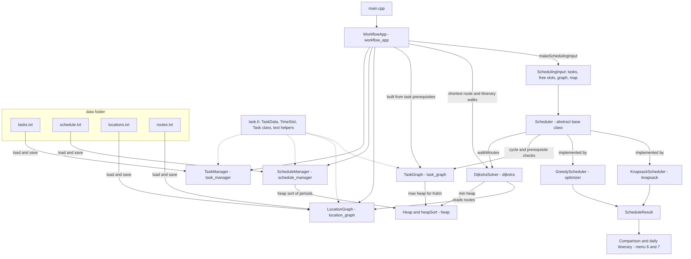

# System Architecture — Priority Based Workflow Optimizer

This document explains how the Phase 3 program is organised: its layers, its modules, how data moves through it, and the main design decisions. For build instructions and usage, see the [README](../README.md).

---

## 1. Overview

The program plans a student's free periods. It reads four text files — tasks, timetable, campus locations and walking routes — and decides which pending task to do in which free period, taking into account:

- each task's **priority**, **duration**, **location** and **prerequisites**,
- the **shortest walking time** between buildings (Dijkstra's algorithm),
- where the student is when the free period starts, and the **walk to the next class** before it begins.

A task is placed in a free period only if

```text
minutes already used + walk to the task + task duration + walk to the next class  <=  length of the free period
```

Two planners build the plan — a **Greedy** planner and a **0/1 Knapsack dynamic-programming** planner — and the program can compare them and show the chosen plan as a timeline of the day.



```text
                 data/tasks.txt   data/schedule.txt   data/locations.txt   data/routes.txt
                       |                 |                    |                  |
                       v                 v                    +--------+---------+
                 TaskManager      ScheduleManager                      v
                 (task_manager)   (schedule_manager)            LocationGraph
                       |          heap sort, free slots        (location_graph)
                       |                 |                             |
                       |                 |                             v
                       |                 |                       DijkstraSolver
                       |                 |                        (dijkstra)
                       v                 v                             |
                 TaskGraph  <------  WorkflowApp  ---------------------+
                 (task_graph)        (workflow_app)
                 DFS, Kahn               |
                       ^                 | makeSchedulingInput()
                       |                 v
                       |          SchedulingInput
                       |                 |
                       |                 v
                       +-------  Scheduler (abstract)  ------> walkMinutes() -> DijkstraSolver
                                   |             |
                          GreedyScheduler   KnapsackScheduler
                            (optimizer)        (knapsack)
                                   \             /
                                    v           v
                                    ScheduleResult
                                          |
                                          v
                          Comparison and daily itinerary (menus 6 and 7)
```

---

## 2. Two styles in one C++ program

Every file is C++ (`.h` / `.cpp`, compiled with `g++`). The code is written in two styles, matching the two course parts of the project.

### 2.1 Data-structure modules (C-style procedural code)

Plain `struct`s, arrays, pointers, singly linked lists, `malloc` / `free`, and functions with a module prefix.

| Module | Prefix | Main structure | Responsibility |
|---|---|---|---|
| `task` (Part 1) | `pu_` | `TaskData`, `TimeSlot` | Shared types, project limits, text helpers (read a line, split at `|`, parse numbers and `HH:MM` times) |
| `task_manager` | `tm_` | `TaskManager` — dynamic array of `TaskData` | Load, validate, find, display, update, delete, mark done and save tasks |
| `schedule_manager` | `sm_` | `ScheduleManager` — fixed arrays of `Period` and `TimeSlot` | Load and validate periods, overlap check, sort by start time, build free slots, add / delete / save periods |
| `location_graph` | `lg_` | `LocationGraph` — vertices with linked lists of `RouteNode` | Weighted undirected campus graph; add / remove routes, find by ID or name, display, load and save |
| `task_graph` | `tg_` | `TaskGraph` — vertices with linked lists of `DependencyNode` | Directed prerequisite graph; DFS cycle detection, prerequisite check, Kahn's topological sort |

### 2.2 Object-oriented classes

| Class | File | Role |
|---|---|---|
| `Task` | `task.h/.cpp` (Part 2) | Read-only object view of a `TaskData`; ranking rule through `operator>`, `operator==`, `operator<<` |
| `Heap` | `heap.h/.cpp` | Binary min-heap or max-heap in a growing array; copying is deleted. `heapSort()` is a free function in the same module |
| `DijkstraSolver` | `dijkstra.h/.cpp` | Shortest walking route and time over a `LocationGraph` (read through a `const` pointer) |
| `ScheduleResult` | `scheduler.h/.cpp` | One plan: planned tasks, unplanned tasks with reasons, per-slot usage, totals and percentages (fixed arrays, so it can be copied safely) |
| `Scheduler` | `scheduler.h/.cpp` | Abstract base class: shared planning rules and helpers; pure virtual `name()` and `planSlots()` |
| `GreedyScheduler` | `optimizer.h/.cpp` | Greedy planner — overrides `name()` and `planSlots()` |
| `KnapsackScheduler` | `knapsack.h/.cpp` | 0/1 Knapsack DP planner — overrides `name()` and `planSlots()` |
| `WorkflowApp` | `workflow_app.h/.cpp` | The application: owns every module, runs the menus, connects everything; copying is deleted |

`main.cpp` only creates a `WorkflowApp`, calls `initialize()` and `run()`.

---

## 3. Layers

| Layer | Modules | Input | Output |
|---|---|---|---|
| 1. Entry point | `main.cpp` | — | A running `WorkflowApp` |
| 2. Application and menus | `workflow_app` | User choices | Calls into every module; prints results |
| 3. Task management | `task`, `task_manager` | `tasks.txt`, menu edits | Array of `TaskData`, `Task` objects |
| 4. Schedule management | `schedule_manager`, `heap` | `schedule.txt`, menu edits | Sorted periods, free slots (`TimeSlot`) |
| 5. Graphs and navigation | `location_graph`, `dijkstra`, `task_graph`, `heap` | `locations.txt`, `routes.txt`, task prerequisites | Walking times and routes, cycle check, topological order |
| 6. Scheduling | `scheduler`, `optimizer`, `knapsack` | `SchedulingInput` | `ScheduleResult` |
| 7. Persistence | load / save functions in layers 3–5; `pu_read_line()` | The four text files | In-memory data, and the files written back |

`WorkflowApp` is the only module that knows about all the others. Lower modules never call upward.

---

## 4. Header dependencies

`A -> B` means "A includes B". There are no circular includes, and every header has an include guard.

| File | Includes (project headers) |
|---|---|
| `task.h`, `heap.h` | none |
| `location_graph.h`, `task_graph.h` | `task.h` |
| `task_manager.h`, `schedule_manager.h`, `dijkstra.h` | `task.h`, `location_graph.h` |
| `scheduler.h` | `task.h`, `task_graph.h`, `location_graph.h` |
| `optimizer.h`, `knapsack.h` | `scheduler.h` |
| `workflow_app.h` | `task.h`, `task_manager.h`, `schedule_manager.h`, `location_graph.h`, `task_graph.h`, `scheduler.h`, `optimizer.h`, `knapsack.h` |
| `schedule_manager.cpp`, `task_graph.cpp`, `dijkstra.cpp` | additionally `heap.h` |
| `scheduler.cpp`, `workflow_app.cpp` | additionally `dijkstra.h` |

`task_manager` and `schedule_manager` include `location_graph.h` only to print building names. [`dependencies.md`](dependencies.md) shows the Phase 2 version of these dependencies and the team's commit order.

---

## 5. Data flow

### 5.1 Start-up

```text
main()
 └─ WorkflowApp::initialize() -> loadAllData()
     ├─ lg_load_locations("data/locations.txt")   buildings
     ├─ lg_load_routes("data/routes.txt")         two-way paths, stored in both lists
     ├─ sm_load_from_file("data/schedule.txt")    each period validated, then heapSort() by start time,
     │                                            then free slots rebuilt (class before and after each one)
     ├─ tm_load_from_file("data/tasks.txt")       each task validated
     ├─ rebuildTaskGraph()                        one vertex per task, one edge per prerequisite
     ├─ rebuildTaskObjects()                      Task objects (new[])
     └─ validateData()                            every task / class location exists, no prerequisite cycle
```

A bad line in any file is reported with its file name and line number and skipped; the rest of the file is still loaded. On success the program prints `[OK] Existing data loaded from data/ directory.`

### 5.2 Planning (menu 6)

```text
WorkflowApp::makeSchedulingInput()
   tasks, free slots, task graph, campus map   ->   SchedulingInput
        │
        v
Scheduler::plan(input, result)          (same for both planners)
   1. clear the result; record total free minutes and total priority of pending tasks
   2. stop if the prerequisites contain a cycle (tg_find_cycle)
   3. planSlots(input, result)          <- pure virtual: Greedy or Knapsack
   4. give every unplanned task one reason:
        waits for a prerequisite | location cannot be reached on foot |
        longer than every free slot | not enough free time left
        │
        v
ScheduleResult  ->  summary, comparison (menu 6 -> 3), itinerary (menu 7)
```

Helpers used by both planners (static members of `Scheduler`):

| Helper | What it does |
|---|---|
| `walkMinutes()` | Walking time from `DijkstraSolver::shortestTime()`; 0 for the same or an unknown location, −1 if unreachable |
| `isPending()` | True if the task is not DONE and not planned yet |
| `prerequisitesReady()` | True if every prerequisite is DONE or already planned (`tg_prerequisites_done()`) |
| `slotStartLocation()` | Where the student starts: the class just before the slot, or where the previous free slot ended |

### 5.3 Greedy planner (`optimizer.cpp`)

For each free slot in time order:

1. Find the start location.
2. Among pending, ready, reachable tasks that fit (walk in + duration + walk to the next class within the minutes left), pick the best one by `Task::operator>` — higher priority, then shorter, then lower ID.
3. Add it to the plan; the student is now at that task's building. Repeat step 2 until nothing fits.
4. Add the walk to the next class to the slot's usage.

A prerequisite planned earlier in the same slot counts as ready.

### 5.4 Knapsack planner (`knapsack.cpp`)

For each free slot in time order:

1. **Items:** pending, ready, reachable tasks; weight = duration; value = `priority × (slot length + 1) + duration` (priority decides, duration breaks ties).
2. **DP:** table `best[i][w]` of size `(n + 1) × (W + 1)` (allocated with `new[]`); walk back through it to find the chosen set.
3. **Walking check:** order the chosen tasks by nearest building next and time the real route, including the walk to the next class.
4. **Shrink and repeat:** if the route is `k` minutes too long, reduce the capacity by `k` and solve again; if a building on the way is unreachable, reduce it by 1.
5. Store the plan for the slot.

Prerequisites count as ready only if they were planned in an earlier slot.

**Optimality:** the DP is exact for task durations within one slot. Walking is added afterwards with a heuristic order, and slots are planned one after another, so neither planner guarantees the best plan for the whole day.

### 5.5 Editing and saving

- Menu edits call the `tm_`, `sm_` and `lg_` functions. Adding or updating a task rebuilds the task graph; if the change creates a cycle, it is undone.
- Deleting a task that another task depends on is refused.
- Any edit marks the data as changed and clears the current plan, because it no longer matches the data.
- **Save Data** (menu 8) writes all four files through `std::ofstream`; on exit the program asks to save if something changed. **Load Data** (menu 9) frees everything and loads the files again.

---

## 6. Design decisions

| Decision | Reason |
|---|---|
| No STL containers or algorithms | The course goal is to implement the data structures (heap, graphs, lists) by hand |
| Adjacency lists for both graphs | Both graphs are sparse; neighbour lists match how Dijkstra, DFS and Kahn's algorithm walk the graph |
| Binary heap with lazy deletion in Dijkstra | Simple heap without a decrease-key operation; stale entries are skipped when popped |
| One heap class for min and max | `MIN_HEAP` for Dijkstra, `MAX_HEAP` for Kahn's algorithm (most important ready task first) |
| Times stored as minutes since midnight | Easy to compare and subtract (12:00 − 11:05 = 720 − 665 = 55) |
| Plan types in `scheduler.h`, not `task.h` | They need the task graph and the campus map; `task.h` must stay the lowest header that every module includes |
| Abstract `Scheduler` with `plan()` + `planSlots()` | The shared rules are written once; each planner only writes its own slot-filling step; `WorkflowApp` can call either planner through a `Scheduler` reference or pointer |
| `ScheduleResult` uses fixed arrays | No dynamic memory, so a plan can be copied safely (for example into `currentPlan`) |
| Copying disabled for `Heap` and `WorkflowApp` | Both own memory; a copy would free the same memory twice |
| Fixed limits (100 tasks, 50 buildings, 50 periods, 5 prerequisites) | Enough for one student's day; keeps arrays simple |
| A new Dijkstra run for every walking time | Simple and correct; fast enough for the project's limits (no caching) |
| Plain-text files with `|` separators | Easy to read and edit by hand; no database needed |

---

## 7. Error handling

| Situation | Behaviour |
|---|---|
| A data file cannot be opened | `[ERROR] Cannot open ... file`; the program continues with the data it has |
| A line breaks a rule (for example priority 11) | `[WARN] <file> line <n>: <reason>, skipped` |
| Overlapping periods, negative or duplicate routes, unknown buildings, duplicate IDs | Rejected by the module that owns the data |
| Prerequisite cycle | Reported at start-up; planning stops with the cycle printed; a menu edit that creates one is undone |
| Unreachable building | Dijkstra reports it; tasks there are not planned ("cannot be reached on foot") |
| Wrong menu input (letters, empty line, out of range) | A message, then the question is asked again |
| End of input (Ctrl+Z / Ctrl+D) | The program stops cleanly |
