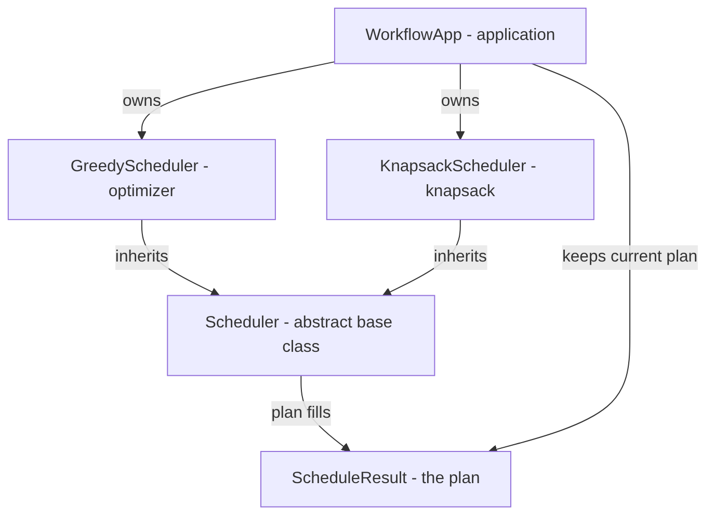

# Object-Oriented Design (OOP)
 
This document describes the classes of the Priority Based Workflow Optimizer, how they relate to each other, and which object-oriented concepts each one demonstrates.
 
For the overall structure see [architecture.md](architecture.md); for the data structures and algorithms see [dsa_design.md](dsa_design.md).
 
---
 
## 1. Where OOP is used
 
The program is written in C++ in two styles:
 
- **Data-structure modules** (`task_manager`, `schedule_manager`, `location_graph`, `task_graph`, and the text helpers in `task`) use plain `struct`s and functions with a prefix (`tm_`, `sm_`, `lg_`, `tg_`, `pu_`). They are **not** classes.
- **Classes** are used where objects with behaviour and a clear interface make the design simpler: the task view, the heap, the shortest-path solver, the planners, the plan result and the application itself.
| Class | File | Responsibility |
|---|---|---|
| `Task` | `task.h/.cpp` | Read-only object view of one task; the project's ranking rule |
| `Heap` | `heap.h/.cpp` | Binary min-heap or max-heap (priority queue) |
| `DijkstraSolver` | `dijkstra.h/.cpp` | Shortest walking route and time on the campus graph |
| `ScheduleResult` | `scheduler.h/.cpp` | One complete plan: planned tasks, unplanned tasks with reasons, slot usage, totals |
| `Scheduler` | `scheduler.h/.cpp` | Abstract base class: shared planning rules and helpers |
| `GreedyScheduler` | `optimizer.h/.cpp` | Greedy planner |
| `KnapsackScheduler` | `knapsack.h/.cpp` | 0/1 Knapsack DP planner |
| `WorkflowApp` | `workflow_app.h/.cpp` | The application: owns everything, runs the menus, connects the modules |
 
---
 
## 2. Class relationships
 

 
```text
                              WorkflowApp
                                   |
       owns (composition)          |          uses
   +-----------+-----------+-------+-------+----------------------+
   |           |           |               |                      |
TaskManager ScheduleManager LocationGraph TaskGraph         DijkstraSolver
 (struct)     (struct)       (struct)      (struct)        (route menu, itinerary)
   |
   +-- Task[] objects (new[]) -------------------------------> Task
   |
   +-- greedyPlanner : GreedyScheduler ----+
   +-- knapsackPlanner : KnapsackScheduler +--- both inherit ---> Scheduler (abstract)
   +-- currentPlan : ScheduleResult                                  |
                                                                     | plan() fills
                                                                     v
                                                               ScheduleResult
 
Scheduler::walkMinutes() --> DijkstraSolver --> Heap (MIN_HEAP)
tg_topological_sort()    --> Heap (MAX_HEAP)
```
 
- **Inheritance ("is-a"):** `GreedyScheduler` and `KnapsackScheduler` are `Scheduler`s.
- **Composition ("has-a"):** `WorkflowApp` contains the managers, graphs, both planners and the current plan as members; they live and die with it.
- **Use ("uses-a"):** `Scheduler` creates a `DijkstraSolver` for walking times; `DijkstraSolver` creates a `Heap`.
---
 
## 3. Classes in detail
 
### 3.1 `Task`
 
```cpp
class Task {
public:
    Task();
    explicit Task(const TaskData& record);
    int getId() const;            // ... and the other getters
    bool hasPrerequisite(int taskId) const;
    bool ranksHigherThan(const Task& other) const;
    bool operator>(const Task& other) const;
    bool operator==(const Task& other) const;
private:
    TaskData data;
};
std::ostream& operator<<(std::ostream& out, const Task& task);
```
 
| Concept | How |
|---|---|
| Encapsulation | The `TaskData` record is private; other code can only read it through `const` getters |
| `explicit` constructor | A `TaskData` is never turned into a `Task` by accident |
| Operator overloading | `a > b` means "a should be done before b" (higher priority, then shorter, then lower ID); `==` compares IDs; `<<` prints `T3 Submit Lab Record (15 min, P10)` |
 
Used by the "pending tasks by priority" list, the Greedy planner and the Knapsack route ordering.
 
### 3.2 `Heap`
 
```cpp
class Heap {
private:
    HeapNode* data;  int count;  int capacity;  HeapType type;
    void siftUp(int index);
    void grow();
public:
    explicit Heap(HeapType type, int initialCapacity = 16);
    ~Heap();
    Heap(const Heap&) = delete;
    Heap& operator=(const Heap&) = delete;
    void push(int key, int value);
    bool pop(HeapNode& out);
    bool top(HeapNode& out) const;
    bool isEmpty() const;  int size() const;  void clear();
};
```
 
| Concept | How |
|---|---|
| Encapsulation | The array and its size are private; only heap operations are public |
| Constructor / destructor | The constructor allocates the array with `new[]`; the destructor frees it with `delete[]` |
| Rule of Three | The class owns memory, so the copy constructor and copy assignment are **deleted** — two copies would free the same array |
| One class, two behaviours | `MIN_HEAP` (Dijkstra) or `MAX_HEAP` (Kahn's algorithm) is chosen in the constructor |
 
### 3.3 `DijkstraSolver`
 
```cpp
class DijkstraSolver {
public:
    explicit DijkstraSolver(const LocationGraph* campusGraph);
    DijkstraStatus findPath(int sourceId, int destinationId, ShortestPath& result) const;
    bool shortestTime(int sourceId, int destinationId, int& minutes) const;
    void printPath(const ShortestPath& path) const;
    static const char* statusMessage(DijkstraStatus status);
private:
    const LocationGraph* graph;
};
```
 
| Concept | How |
|---|---|
| Encapsulation | The map pointer is private; it points to `const`, so the solver can only read the map |
| Initializer list | The constructor stores the pointer with `: graph(campusGraph)` |
| `const` member functions | `findPath()`, `shortestTime()` and `printPath()` never change the object or the map |
| `static` member function | `statusMessage()` needs no object: `DijkstraSolver::statusMessage(status)` |
| Result by reference | `findPath()` returns the status and fills the route through `ShortestPath&` |
| Abstraction | Callers ask for a route or a time; the heap, arrays and relaxation stay hidden |
 
### 3.4 `ScheduleResult`
 
| Part | Members |
|---|---|
| Private data | `algorithmName`, fixed arrays `planned[MAX_TASKS]`, `deferred[MAX_TASKS]`, `slots[MAX_SLOTS]` with their counts, `freeMinutes`, `achievedPriority`, `possiblePriority` |
| Building a plan | `clear()`, `addPlanned()`, `addDeferred()`, `addSlot()`, `setTotals()` |
| Reading a plan | `getPlannedCount()`, `getPlanned()`, `getDeferred()`, `getSlot()`, `isPlanned()`, `getTaskMinutes()`, `getWalkingMinutes()`, `getAchievedPriority()`, `getPriorityPercent()`, `getTimeUsePercent()`, ... |
 
| Concept | How |
|---|---|
| Encapsulation | Planners can only add to a plan through its methods; counts and totals stay consistent (`addPlanned()` also adds the task's priority) |
| Safe copying | It holds only fixed arrays and numbers, so the compiler-generated copy is correct — `WorkflowApp` copies a plan into `currentPlan` |
 
### 3.5 `Scheduler` (abstract base class)
 
```cpp
class Scheduler {
public:
    virtual ~Scheduler();
    virtual const char* name() const = 0;
    bool plan(const SchedulingInput& input, ScheduleResult& result) const;
protected:
    virtual bool planSlots(const SchedulingInput& input, ScheduleResult& result) const = 0;
    static int walkMinutes(const LocationGraph* map, int fromId, int toId);
    static bool isPending(const TaskData& task, const ScheduleResult& result);
    static bool prerequisitesReady(const SchedulingInput& input, int taskId, const ScheduleResult& result);
    static int slotStartLocation(const TimeSlot& slot, int lastLocationId);
};
```
 
| Concept | How |
|---|---|
| Abstract class | `name()` and `planSlots()` are **pure virtual** (`= 0`), so no `Scheduler` object can be created — only derived planners |
| Abstraction | Callers only use `plan()` and `name()`; how a slot is filled is hidden in each planner |
| `protected` | `planSlots()` and the helpers are for derived classes only, not for outside code |
| Virtual destructor | A planner used through a `Scheduler` pointer or reference is always cleaned up correctly |
| Template Method pattern | `plan()` is written once: set totals, stop on a prerequisite cycle, call `planSlots()`, give reasons for unplanned tasks. Only the `planSlots()` step differs between planners |
| `static` helpers | Shared tools that need no object: walking time (Dijkstra), pending check, prerequisite check, slot start location |
 
### 3.6 `GreedyScheduler` and `KnapsackScheduler`
 
```cpp
class GreedyScheduler : public Scheduler {
public:
    const char* name() const override;            // "Greedy"
protected:
    bool planSlots(const SchedulingInput& input, ScheduleResult& result) const override;
};
 
class KnapsackScheduler : public Scheduler {
public:
    const char* name() const override;            // "0/1 Knapsack"
protected:
    bool planSlots(const SchedulingInput& input, ScheduleResult& result) const override;
};
```
 
| Concept | How |
|---|---|
| Inheritance | Both reuse `plan()` and the helpers from `Scheduler` |
| Overriding | Each gives its own `name()` and `planSlots()`; `override` makes the compiler check that the signature really matches the base class |
| Strategy-like design | The two planners are interchangeable: the application can run either one through the same `Scheduler` interface |
 
### 3.7 `WorkflowApp`
 
| Concept | How |
|---|---|
| Composition | Members: `TaskManager`, `ScheduleManager`, `LocationGraph`, `TaskGraph`, a `Task` array, `GreedyScheduler greedyPlanner`, `KnapsackScheduler knapsackPlanner`, `ScheduleResult currentPlan` |
| Encapsulation | Only `initialize()` and `run()` are public; menus, input reading, editing and saving are private |
| Constructor / destructor | The constructor prepares empty modules; the destructor calls `releaseData()`, which frees the task list, both graphs and the `Task` array |
| Copying disabled | The copy constructor and copy assignment are deleted, because the object owns memory |
| Runtime polymorphism | `runPlanner(const Scheduler& planner)` is called with `greedyPlanner` or `knapsackPlanner`; `comparePlanners()` loops over `const Scheduler* planners[2]` and calls `planners[i]->plan(...)` — the real object decides which `planSlots()` runs |
 
---
 
## 4. OOP concepts — summary
 
| Concept | Where |
|---|---|
| Classes and objects | `Task`, `Heap`, `DijkstraSolver`, `ScheduleResult`, `Scheduler`, `GreedyScheduler`, `KnapsackScheduler`, `WorkflowApp` |
| Encapsulation | Private data in every class above |
| Abstraction | `Scheduler` (pure virtual interface); `DijkstraSolver` hides the algorithm |
| Inheritance | `GreedyScheduler : public Scheduler`, `KnapsackScheduler : public Scheduler` |
| Runtime polymorphism | Calls through `const Scheduler&` and `const Scheduler*` in `WorkflowApp` |
| Overriding (`override`) | `name()` and `planSlots()` in both planners |
| Pure virtual functions / abstract class | `Scheduler::name()`, `Scheduler::planSlots()` |
| Virtual destructor | `Scheduler::~Scheduler()` |
| Constructors and destructors | `Heap`, `WorkflowApp`, `ScheduleResult`, `Task` |
| Initializer list | `DijkstraSolver`, `Task(const TaskData&)` |
| `explicit` constructors | `Task`, `Heap`, `DijkstraSolver` |
| `const` member functions | Getters of `Task` and `ScheduleResult`; `DijkstraSolver` queries; `Scheduler::plan()` and `planSlots()` |
| `static` member functions | `DijkstraSolver::statusMessage()`, `Scheduler` helpers |
| Operator overloading | `Task::operator>`, `Task::operator==`, `operator<<` for `Task` |
| Deleted copy operations (Rule of Three) | `Heap`, `WorkflowApp` |
| Composition | `WorkflowApp` members |
| Template Method pattern | `Scheduler::plan()` calling `planSlots()` |
 
---
 
## 5. Not part of the implementation
 
An earlier design draft for this project described classes such as `Location`, `FixedActivity`, `Schedule`, `RouteManager`, `TimeOptimizer`, `Itinerary`, `FileManager` and `ChronoSpatialSystem`, with STL `vector`s and strings and a brute-force optimiser. **None of these exist in the final code.** Their jobs are done by the modules and classes described above — for example, file reading is done by each module's load and save functions, the timetable by `schedule_manager`, walking times by `DijkstraSolver`, and planning by the `Scheduler` classes.
 
